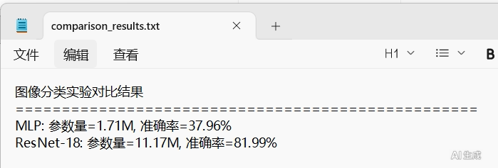
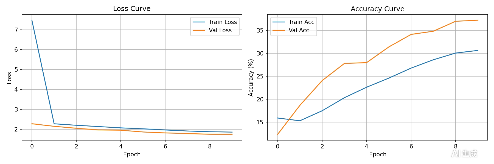
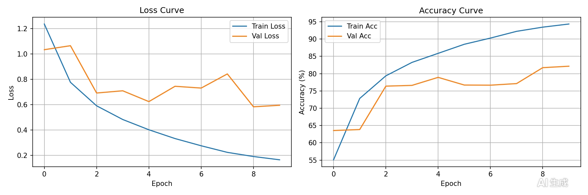
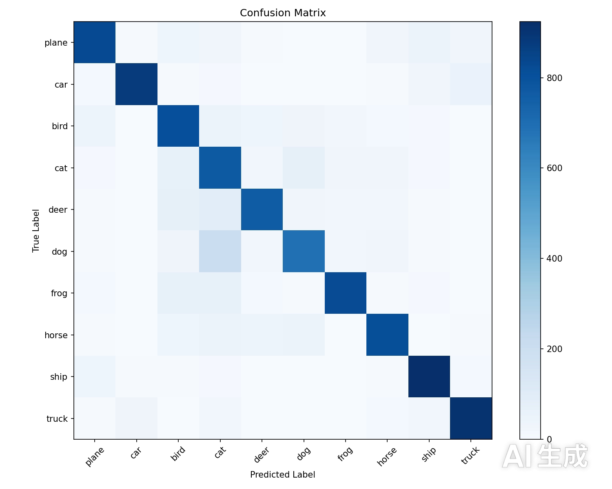
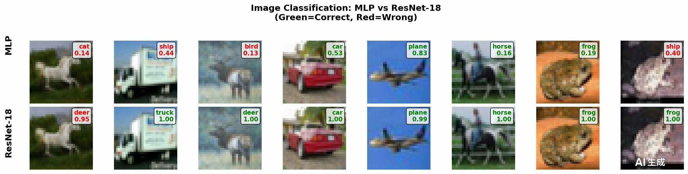
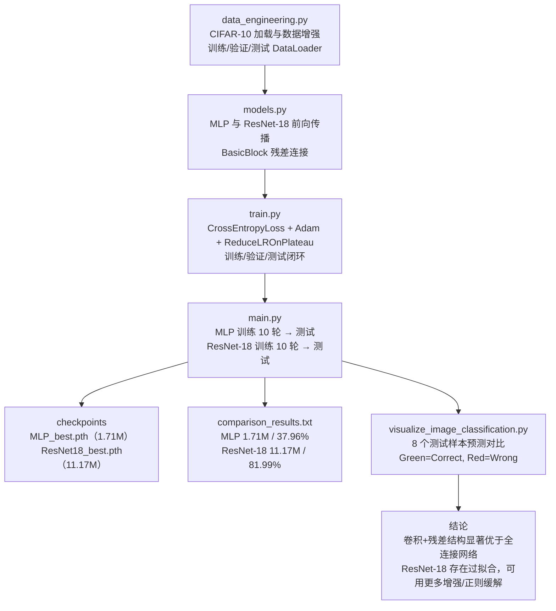

---
AIGC:
    Label: "1"
    ContentProducer: 001191440300708461136T1XGW3
    ProduceID: 278e15af09c947df43b62560d322c33a_b22ba832b41711f1812e525400248c00
    ReservedCode1: 3UstoPOaNpLsUL1e55CmKE915wyDcDShomfUbMtKDMBYFwAmmZ0//pLoLxNvHV7AF3Xn6NxuZ0SeWA5tPztpF72qadtKzJCIVa/tZDSzyBPJoCy6hxhiJ8wHz3EFL4tYmrP/kUdtBXE4sfkDkMuc77WBEseD7wQSlw1NkMfmcpdwbzQzz6gqkmgcUpE=
    ContentPropagator: 001191440300708461136T1XGW3
    PropagateID: 278e15af09c947df43b62560d322c33a_b22ba832b41711f1812e525400248c00
    ReservedCode2: 3UstoPOaNpLsUL1e55CmKE915wyDcDShomfUbMtKDMBYFwAmmZ0//pLoLxNvHV7AF3Xn6NxuZ0SeWA5tPztpF72qadtKzJCIVa/tZDSzyBPJoCy6hxhiJ8wHz3EFL4tYmrP/kUdtBXE4sfkDkMuc77WBEseD7wQSlw1NkMfmcpdwbzQzz6gqkmgcUpE=
title: CIFAR-10图像分类
published: 2026-08-19
pinned: false
description: 基于 PyTorch 的 CIFAR-10 图像分类实验：围绕 CIFAR-10 数据集搭建「数据工程 → 模型定义 → 训练与测试 → 可视化对比」完整流程，分别用多层感知机（MLP）与 ResNet-18 完成 10 类彩色图像分类，并对比两种模型的参数量、测试准确率、训练曲线、混淆矩阵与预测结果。
tags: [深度学习, 图像分类, CIFAR-10, MLP, ResNet-18, PyTorch]
category: 深度学习
licenseName: ''
author: Mudrock
sourceLink: ''
slug: cifar10-image-classification
image: ''
---


本文是在 PyTorch 框架下围绕 CIFAR-10 数据集搭建「数据工程 → 模型定义 → 训练与测试 → 可视化对比」的完整流程，分别用多层感知机（MLP）与 ResNet-18 完成 10 类彩色图像的分类，并对两种模型的参数量、测试准确率、训练曲线、混淆矩阵与预测结果做对比分析。

## 一、实验目的及要求

1. 掌握 PyTorch 数据加载与预处理流程。
2. 理解并实现两种神经网络模型（MLP 和 ResNet-18）的前向传播。
3. 掌握模型训练、验证和测试的完整流程。
4. 对比分析不同模型在图像分类任务上的性能差异。

## 二、实验原理与内容

### 2.1 两种模型的原理

**MLP（多层感知机）**：全连接网络，将图像展平后通过三层线性层 + ReLU + Dropout 完成分类，无法捕捉空间结构信息。

**ResNet-18**：基于残差连接的卷积神经网络，通过 BasicBlock 解决深层网络梯度消失问题，有效提取图像局部与全局特征。

| 对比项 | MLP | ResNet-18 |
| --- | --- | --- |
| 网络类型 | 全连接网络 | 残差卷积网络 |
| 输入处理 | 先 Flatten 展平为 3072 维向量，丢失空间结构 | 保持 3×32×32 特征图，逐层提取局部与全局特征 |
| 主要结构 | Flatten → FC(3072,512) → ReLU → Dropout → FC(512,256) → ReLU → Dropout → FC(256,10) | Conv1 → 4 个残差层（每层 2 个 BasicBlock，通道 64→128→256→512）→ 全局平均池化 → FC(512,10) |
| 关键机制 | Dropout(0.3) 抑制过拟合，Kaiming 初始化 | BasicBlock 的恒等/投影 shortcut 残差连接，缓解梯度消失 |
| 参数量 | 1.71M | 11.17M |
| 测试准确率 | 37.96% | 81.99% |

### 2.2 实验内容与脚本顺序

1. 分别运行 `data_engineering.py`、`models.py`、`train.py` 文件，确认各自能够正常执行。
2. 运行 `python main.py` 完成完整实验。
3. 运行 `python visualize_image_classification.py` 生成可视化结果。

| 顺序 | 脚本文件 | 类型 | 验证方式 |
| :---: | :--- | :--- | :--- |
| 1 | `data_engineering.py` | 数据工程 | 直接运行，确认数据加载与迭代器创建无误 |
| 2 | `models.py` | 模型定义 | 直接运行，观察模拟输入的输出形状 |
| 3 | `train.py` | 训练与测试 | 直接运行，观察各测试环节输出 |
| 4 | `main.py` | 主程序 | 前三者测试通过后运行，完成完整实验 |
| 5 | `visualize_image_classification.py` | 可视化 | `main.py` 生成权重后运行，输出对比图 |

## 三、实验软硬件环境

| 类别 | 配置 |
| --- | --- |
| 操作系统 | Windows 11 |
| 开发工具 | PyCharm 2024.2 |
| 编程语言 | Python 3 |
| 深度学习框架 | PyTorch 2.7.1 + torchvision |
| 依赖库 | matplotlib、scikit-learn、tqdm、numpy |
| 数据集 | CIFAR-10（50000 张训练 + 10000 张测试，10 类 32×32 彩色图） |
| 模型 | MLP、ResNet-18 |

## 四、实验过程

### 4.1 data_engineering.py — 数据工程模块

**总体任务**：补全代码，使程序能够加载 CIFAR-10 数据集，并将其封装为可供模型训练和验证使用的数据迭代器。

实现要点：

- 训练集 transform 使用 `RandomCrop(32, padding=4)` + `RandomHorizontalFlip(0.5)` 做数据增强，再 `ToTensor()` 与 `Normalize(mean, std)` 标准化；测试集只保留 `ToTensor()` + `Normalize()`，去掉随机增强。
- 用 `datasets.CIFAR10(root, train=True/False, download=True, transform=...)` 分别加载训练集与测试集。
- 用 `random_split` 按 `9:1` 划分训练/验证子集，并用 `generator=torch.Generator().manual_seed(42)` 固定随机种子保证可复现。
- `random_split` 返回的是 Subset，需要把验证集的 `transform` 改回 `test_transform`，避免验证阶段带随机增强。
- 三个 DataLoader 中训练集 `shuffle=True`、验证/测试集 `shuffle=False`；`pin_memory` 依据 `torch.cuda.is_available()` 决定。

```python
import torch
from torchvision import transforms, datasets
from torch.utils.data import DataLoader, random_split


class CIFAR10Data:

    def __init__(self, data_dir='./data', batch_size=64, num_workers=2):
        self.data_dir = data_dir
        self.batch_size = batch_size
        self.num_workers = num_workers

        # CIFAR-10 预计算的通道均值与标准差，用于标准化
        self.mean = (0.4914, 0.4822, 0.4465)
        self.std = (0.2023, 0.1994, 0.2010)

        # 训练集 transform：随机裁剪 + 水平翻转做数据增强，提升泛化能力
        self.train_transform = transforms.Compose([
            transforms.RandomCrop(32, padding=4),
            transforms.RandomHorizontalFlip(p=0.5),
            transforms.ToTensor(),
            transforms.Normalize(self.mean, self.std)
        ])

        # 测试集 transform：只做 ToTensor 与归一化，不引入随机增强
        self.test_transform = transforms.Compose([
            transforms.ToTensor(),
            transforms.Normalize(self.mean, self.std)
        ])

    def load_data(self):
        # 分别加载训练集（50000 张）与测试集（10000 张），本地缺失时自动下载
        full_train = datasets.CIFAR10(
            root=self.data_dir,
            train=True,
            download=True,
            transform=self.train_transform
        )

        test_dataset = datasets.CIFAR10(
            root=self.data_dir,
            train=False,
            download=True,
            transform=self.test_transform
        )

        print(f"训练集大小: {len(full_train)}")
        print(f"测试集大小: {len(test_dataset)}")

        return full_train, test_dataset

    def split_data(self, full_train, val_ratio=0.1):
        # 按 9:1 划分训练/验证子集，固定随机种子保证可复现
        total_size = len(full_train)
        val_size = int(total_size * val_ratio)
        train_size = total_size - val_size

        train_dataset, val_dataset = random_split(
            full_train,
            [train_size, val_size],
            generator=torch.Generator().manual_seed(42)
        )

        # random_split 返回 Subset 且不复制数据，需改回原数据集的 transform 去掉增强
        val_dataset.dataset.transform = self.test_transform

        print(f"训练子集大小: {len(train_dataset)}")
        print(f"验证子集大小: {len(val_dataset)}")

        return train_dataset, val_dataset

    def get_loaders(self, val_ratio=0.1):
        full_train, test_dataset = self.load_data()
        train_dataset, val_dataset = self.split_data(full_train, val_ratio)

        # 训练集打乱顺序，验证/测试集保持顺序；pin_memory 在 CUDA 可用时开启以加速传输
        train_loader = DataLoader(
            train_dataset,
            batch_size=self.batch_size,
            shuffle=True,
            num_workers=self.num_workers,
            pin_memory=True if torch.cuda.is_available() else False
        )

        val_loader = DataLoader(
            val_dataset,
            batch_size=self.batch_size,
            shuffle=False,
            num_workers=self.num_workers,
            pin_memory=True if torch.cuda.is_available() else False
        )

        test_loader = DataLoader(
            test_dataset,
            batch_size=self.batch_size,
            shuffle=False,
            num_workers=self.num_workers,
            pin_memory=True if torch.cuda.is_available() else False
        )

        return train_loader, val_loader, test_loader


if __name__ == '__main__':
    data_manager = CIFAR10Data(batch_size=64)
    train_loader, val_loader, test_loader = data_manager.get_loaders()

    # 取出一个 batch 检查数据管道
    images, labels = next(iter(train_loader))
    print(f"图像 batch 形状: {images.shape}")
    print(f"标签 batch 形状: {labels.shape}")
    print(f"图像数值范围: [{images.min():.2f}, {images.max():.2f}]")
```


### 4.2 models.py — 模型定义模块

**总体任务**：补全代码，使两种神经网络模型能够完成从输入图像到分类结果的前向传播计算。

实现要点：

- MLP 的 `forward`：`flatten → fc1 → ReLU → dropout1 → fc2 → ReLU → dropout2 → fc3`，最后一层不加 ReLU 也不加 Softmax，直接把 logits 交给 `CrossEntropyLoss`。
- BasicBlock 的 `forward`：记录 `identity = self.shortcut(x)`，主干走 `conv1 → bn1 → ReLU → conv2 → bn2`，再与 identity 相加后过 ReLU，完成残差连接。
- ResNet-18 整体结构（`_make_layer`、全局平均池化、FC）由任务提供，阅读并理解即可。

```python
import torch
import torch.nn as nn
import torch.nn.functional as F


class MLP(nn.Module):

    def __init__(self, num_classes=10, dropout=0.3):
        super(MLP, self).__init__()

        self.flatten = nn.Flatten()
        self.fc1 = nn.Linear(32 * 32 * 3, 512)
        self.dropout1 = nn.Dropout(dropout)
        self.fc2 = nn.Linear(512, 256)
        self.dropout2 = nn.Dropout(dropout)
        self.fc3 = nn.Linear(256, num_classes)

        self._initialize_weights()

    def _initialize_weights(self):
        # Kaiming 初始化适配 ReLU 激活，偏置置零
        for m in self.modules():
            if isinstance(m, nn.Linear):
                nn.init.kaiming_normal_(m.weight, mode='fan_out', nonlinearity='relu')
                if m.bias is not None:
                    nn.init.constant_(m.bias, 0)

    def forward(self, x):
        x = self.flatten(x)  # [batch, 3, 32, 32] 展平为 [batch, 3072]
        x = F.relu(self.fc1(x))
        x = self.dropout1(x)
        x = F.relu(self.fc2(x))
        x = self.dropout2(x)
        x = self.fc3(x)  # 只输出 logits，不加 Softmax，交给 CrossEntropyLoss 处理
        return x


class BasicBlock(nn.Module):

    def __init__(self, in_channels, out_channels, stride=1):
        super(BasicBlock, self).__init__()

        self.conv1 = nn.Conv2d(
            in_channels, out_channels, kernel_size=3,
            stride=stride, padding=1, bias=False
        )
        self.bn1 = nn.BatchNorm2d(out_channels)

        self.conv2 = nn.Conv2d(
            out_channels, out_channels, kernel_size=3,
            stride=1, padding=1, bias=False
        )
        self.bn2 = nn.BatchNorm2d(out_channels)

        # 输入输出维度不一致时，用 1x1 卷积构建投影 shortcut 对齐维度
        self.shortcut = nn.Sequential()
        if stride != 1 or in_channels != out_channels:
            self.shortcut = nn.Sequential(
                nn.Conv2d(in_channels, out_channels, kernel_size=1,
                          stride=stride, bias=False),
                nn.BatchNorm2d(out_channels)
            )

    def forward(self, x):
        identity = self.shortcut(x)
        out = self.conv1(x)
        out = self.bn1(out)
        out = F.relu(out)
        out = self.conv2(out)
        out = self.bn2(out)
        out += identity  # 主干输出与 shortcut 相加，完成残差连接
        out = F.relu(out)
        return out


class ResNet18(nn.Module):

    def __init__(self, num_classes=10):
        super(ResNet18, self).__init__()

        # 针对 32x32 小图像，用 3x3 步长 1 卷积替代原版 7x7 步长 2 卷积
        self.conv1 = nn.Conv2d(3, 64, kernel_size=3, stride=1, padding=1, bias=False)
        self.bn1 = nn.BatchNorm2d(64)

        # 4 个残差层通道数 64 -> 128 -> 256 -> 512，stride=2 时空间尺寸减半
        self.layer1 = self._make_layer(64, 64, num_blocks=2, stride=1)
        self.layer2 = self._make_layer(64, 128, num_blocks=2, stride=2)
        self.layer3 = self._make_layer(128, 256, num_blocks=2, stride=2)
        self.layer4 = self._make_layer(256, 512, num_blocks=2, stride=2)

        self.avg_pool = nn.AdaptiveAvgPool2d((1, 1))
        self.fc = nn.Linear(512, num_classes)

        self._initialize_weights()

    def _make_layer(self, in_channels, out_channels, num_blocks, stride):
        layers = []
        # 第一个块负责下采样，后续块保持特征图尺寸不变
        layers.append(BasicBlock(in_channels, out_channels, stride))
        for _ in range(1, num_blocks):
            layers.append(BasicBlock(out_channels, out_channels, stride=1))
        return nn.Sequential(*layers)

    def _initialize_weights(self):
        for m in self.modules():
            if isinstance(m, nn.Conv2d):
                nn.init.kaiming_normal_(m.weight, mode='fan_out', nonlinearity='relu')
            elif isinstance(m, nn.BatchNorm2d):
                nn.init.constant_(m.weight, 1)
                nn.init.constant_(m.bias, 0)

    def forward(self, x):
        x = F.relu(self.bn1(self.conv1(x)))
        x = self.layer1(x)
        x = self.layer2(x)
        x = self.layer3(x)
        x = self.layer4(x)
        x = self.avg_pool(x)
        x = x.view(x.size(0), -1)  # 全局池化后展平为 [batch, 512]
        x = self.fc(x)
        return x


if __name__ == '__main__':
    mlp = MLP(num_classes=10)
    x = torch.randn(2, 3, 32, 32)
    out = mlp(x)
    print(f"MLP 输出形状: {out.shape}")
    print(f"MLP 参数量: {sum(p.numel() for p in mlp.parameters()) / 1e6:.2f}M")

    resnet = ResNet18(num_classes=10)
    out = resnet(x)
    print(f"ResNet 输出形状: {out.shape}")
    print(f"ResNet 参数量: {sum(p.numel() for p in resnet.parameters()) / 1e6:.2f}M")
```


### 4.3 train.py — 训练与测试模块

**总体任务**：补全代码，实现模型训练、验证、测试的完整流程。

实现要点：

- 损失函数 `nn.CrossEntropyLoss()`，优化器 `optim.Adam(lr=0.001, weight_decay=1e-4)`；学习率调度器 `ReduceLROnPlateau(mode='max', factor=0.5, patience=3)`，注意 PyTorch 2.7.1 已移除 `verbose` 参数，需要手动比较前后学习率并打印。
- 单轮训练循环按「梯度清零 → 前向传播 → 计算损失 → 反向传播 → 参数更新」五步实现，顺序不可颠倒。
- 验证流程在 `model.eval()` + `torch.no_grad()` 下推理，仅统计损失与准确率，不做梯度计算。
- 完整训练流程逐轮调用 `train_epoch()` 与 `validate()`，记录 history、按验证准确率保存最优权重，最后保存 history json 并绘制损失/准确率双曲线。
- `test()` 先加载权重，再在测试集上推理，打印测试准确率与 `classification_report`，并绘制混淆矩阵保存为 `confusion_matrix.png`。

```python
import torch
import torch.nn as nn
import torch.optim as optim
from tqdm import tqdm
import json
import os
import matplotlib.pyplot as plt
from sklearn.metrics import confusion_matrix, classification_report
import numpy as np


class Trainer:

    def __init__(self, model, train_loader, val_loader, device,
                 lr=0.001, weight_decay=1e-4, model_name='model'):
        self.model = model.to(device)
        self.train_loader = train_loader
        self.val_loader = val_loader
        self.device = device
        self.model_name = model_name

        # 交叉熵损失 + Adam 优化器（带权重衰减）
        self.criterion = nn.CrossEntropyLoss()
        self.optimizer = optim.Adam(self.model.parameters(), lr=lr, weight_decay=weight_decay)

        # 验证准确率连续 3 轮不提升时学习率减半（PyTorch 2.7.1 无 verbose 参数）
        self.scheduler = optim.lr_scheduler.ReduceLROnPlateau(
            self.optimizer,
            mode='max',
            factor=0.5,
            patience=3
        )

        # 训练历史，用于绘制训练曲线
        self.history = {
            'train_loss': [], 'train_acc': [],
            'val_loss': [], 'val_acc': []
        }
        self.best_acc = 0.0
        self.current_lr = lr

    def train_epoch(self):
        self.model.train()
        total_loss = 0.0
        correct = 0
        total = 0

        pbar = tqdm(self.train_loader, desc='Training')
        for inputs, labels in pbar:
            inputs, labels = inputs.to(self.device), labels.to(self.device)

            # 训练五步：梯度清零 -> 前向传播 -> 计算损失 -> 反向传播 -> 参数更新
            self.optimizer.zero_grad()
            outputs = self.model(inputs)
            loss = self.criterion(outputs, labels)
            loss.backward()
            self.optimizer.step()

            # 统计当前 epoch 的损失与准确率
            total_loss += loss.item()
            _, predicted = outputs.max(1)
            total += labels.size(0)
            correct += predicted.eq(labels).sum().item()

            pbar.set_postfix({
                'loss': f'{loss.item():.4f}',
                'acc': f'{100. * correct / total:.2f}%',
                'lr': f'{self.optimizer.param_groups[0]["lr"]:.6f}'
            })

        avg_loss = total_loss / len(self.train_loader)
        accuracy = 100. * correct / total
        return avg_loss, accuracy

    def validate(self):
        # eval 模式 + no_grad：关闭 Dropout 与 BN 更新，不计算梯度
        self.model.eval()
        total_loss = 0.0
        correct = 0
        total = 0

        with torch.no_grad():
            pbar = tqdm(self.val_loader, desc='Validating')
            for inputs, labels in pbar:
                inputs, labels = inputs.to(self.device), labels.to(self.device)

                outputs = self.model(inputs)
                loss = self.criterion(outputs, labels)

                total_loss += loss.item()
                _, predicted = outputs.max(1)
                total += labels.size(0)
                correct += predicted.eq(labels).sum().item()

                pbar.set_postfix({'acc': f'{100. * correct / total:.2f}%'})

        avg_loss = total_loss / len(self.val_loader)
        accuracy = 100. * correct / total
        return avg_loss, accuracy

    def train(self, epochs=20, save_dir='./checkpoints'):
        os.makedirs(save_dir, exist_ok=True)
        best_model_path = os.path.join(save_dir, f'{self.model_name}_best.pth')

        print(f"\n开始训练 {self.model_name}")
        print(f"设备: {self.device}")
        print(f"初始学习率: {self.optimizer.param_groups[0]['lr']}")
        print(f"总轮数: {epochs}")
        print("=" * 50)

        for epoch in range(epochs):
            print(f"\nEpoch [{epoch + 1}/{epochs}]")

            train_loss, train_acc = self.train_epoch()
            val_loss, val_acc = self.validate()

            self.history['train_loss'].append(train_loss)
            self.history['train_acc'].append(train_acc)
            self.history['val_loss'].append(val_loss)
            self.history['val_acc'].append(val_acc)

            # 调度器按验证准确率调整学习率，变化时手动打印
            old_lr = self.optimizer.param_groups[0]['lr']
            self.scheduler.step(val_acc)
            new_lr = self.optimizer.param_groups[0]['lr']

            if new_lr != old_lr:
                print(f"! 学习率调整: {old_lr:.6f} -> {new_lr:.6f}")

            print(f"Train Loss: {train_loss:.4f}, Acc: {train_acc:.2f}%")
            print(f"Val   Loss: {val_loss:.4f}, Acc: {val_acc:.2f}%")
            print(f"LR: {new_lr:.6f}")

            # 验证准确率创新高时保存当前权重
            if val_acc > self.best_acc:
                self.best_acc = val_acc
                torch.save(self.model.state_dict(), best_model_path)
                print(f"[OK] 保存最佳模型，准确率: {val_acc:.2f}%")

        # 保存训练历史并绘制损失/准确率曲线
        history_path = os.path.join(save_dir, f'{self.model_name}_history.json')
        with open(history_path, 'w') as f:
            json.dump(self.history, f, indent=2)

        self.plot_history(save_dir)

        return self.history

    def plot_history(self, save_dir):
        fig, axes = plt.subplots(1, 2, figsize=(12, 4))

        axes[0].plot(self.history['train_loss'], label='Train Loss')
        axes[0].plot(self.history['val_loss'], label='Val Loss')
        axes[0].set_xlabel('Epoch')
        axes[0].set_ylabel('Loss')
        axes[0].set_title('Loss Curve')
        axes[0].legend()
        axes[0].grid(True)

        axes[1].plot(self.history['train_acc'], label='Train Acc')
        axes[1].plot(self.history['val_acc'], label='Val Acc')
        axes[1].set_xlabel('Epoch')
        axes[1].set_ylabel('Accuracy (%)')
        axes[1].set_title('Accuracy Curve')
        axes[1].legend()
        axes[1].grid(True)

        plt.tight_layout()
        plt.savefig(os.path.join(save_dir, f'{self.model_name}_curves.png'), dpi=150)
        plt.close()


def test(model, test_loader, device, model_path=None, num_classes=10):
    # 加载训练好的最优权重，map_location 保证跨设备加载
    if model_path is not None:
        model.load_state_dict(torch.load(model_path, map_location=device))
        print(f"加载模型: {model_path}")

    model = model.to(device)
    model.eval()

    all_preds = []
    all_labels = []
    correct = 0
    total = 0

    # 推理阶段不计算梯度，收集全部预测用于生成分类报告与混淆矩阵
    with torch.no_grad():
        for inputs, labels in tqdm(test_loader, desc='Testing'):
            inputs, labels = inputs.to(device), labels.to(device)
            outputs = model(inputs)
            _, predicted = outputs.max(1)

            total += labels.size(0)
            correct += predicted.eq(labels).sum().item()

            all_preds.extend(predicted.cpu().numpy())
            all_labels.extend(labels.cpu().numpy())

    accuracy = 100. * correct / total
    print(f"\n测试准确率: {accuracy:.2f}%")

    classes = ('plane', 'car', 'bird', 'cat', 'deer',
               'dog', 'frog', 'horse', 'ship', 'truck')
    print("\n分类报告:")
    print(classification_report(all_labels, all_preds, target_names=classes, digits=4))

    # 混淆矩阵热力图：行为真实标签，列为预测标签
    cm = confusion_matrix(all_labels, all_preds)
    plt.figure(figsize=(10, 8))
    plt.imshow(cm, interpolation='nearest', cmap=plt.cm.Blues)
    plt.title('Confusion Matrix')
    plt.colorbar()
    tick_marks = np.arange(num_classes)
    plt.xticks(tick_marks, classes, rotation=45)
    plt.yticks(tick_marks, classes)
    plt.ylabel('True Label')
    plt.xlabel('Predicted Label')
    plt.tight_layout()
    plt.savefig('confusion_matrix.png', dpi=150)
    plt.close()

    return accuracy


if __name__ == '__main__':
    from models import MLP, ResNet18
    from torch.utils.data import TensorDataset, DataLoader

    # 构造模拟数据，快速验证训练流程而无需下载数据集
    batch_size = 16
    num_samples = 64
    x = torch.randn(num_samples, 3, 32, 32)
    y = torch.randint(0, 10, (num_samples,))

    dataset = TensorDataset(x, y)
    train_loader = DataLoader(dataset, batch_size=batch_size, shuffle=True)
    val_loader = DataLoader(dataset, batch_size=batch_size, shuffle=False)
    test_loader = DataLoader(dataset, batch_size=batch_size, shuffle=False)

    device = torch.device('cuda' if torch.cuda.is_available() else 'cpu')
    print(f"使用设备: {device}\n")

    print("=" * 50)
    print("测试 1: MLP Trainer 初始化与单 epoch 训练")
    print("=" * 50)
    mlp = MLP(num_classes=10)
    trainer_mlp = Trainer(mlp, train_loader, val_loader, device, model_name='MLP_test')
    train_loss, train_acc = trainer_mlp.train_epoch()
    print(f"训练 Loss: {train_loss:.4f}, Acc: {train_acc:.2f}%")
    val_loss, val_acc = trainer_mlp.validate()
    print(f"验证 Loss: {val_loss:.4f}, Acc: {val_acc:.2f}%")

    print("\n" + "=" * 50)
    print("测试 2: ResNet18 Trainer 初始化与单 epoch 训练")
    print("=" * 50)
    resnet = ResNet18(num_classes=10)
    trainer_resnet = Trainer(resnet, train_loader, val_loader, device, model_name='ResNet18_test')
    train_loss, train_acc = trainer_resnet.train_epoch()
    print(f"训练 Loss: {train_loss:.4f}, Acc: {train_acc:.2f}%")
    val_loss, val_acc = trainer_resnet.validate()
    print(f"验证 Loss: {val_loss:.4f}, Acc: {val_acc:.2f}%")

    print("\n" + "=" * 50)
    print("测试 3: MLP 完整训练流程（2 epochs）")
    print("=" * 50)
    mlp2 = MLP(num_classes=10)
    trainer_full = Trainer(mlp2, train_loader, val_loader, device, model_name='MLP_full')
    history = trainer_full.train(epochs=2, save_dir='./checkpoints_test')
    print(f"训练历史记录键: {list(history.keys())}")
    print(f"最佳验证准确率: {trainer_full.best_acc:.2f}%")

    print("\n" + "=" * 50)
    print("测试 4: test 函数（使用刚保存的模型）")
    print("=" * 50)
    model_path = './checkpoints_test/MLP_full_best.pth'
    mlp3 = MLP(num_classes=10)
    acc = test(mlp3, test_loader, device, model_path=model_path)
    print(f"test 函数返回准确率: {acc:.2f}%")

    import shutil

    if os.path.exists('./checkpoints_test'):
        shutil.rmtree('./checkpoints_test')
    print("\n所有测试通过！")
```


### 4.4 main.py — 主程序

**总体任务**：阅读并理解代码，明确整个实验的执行流程。运行命令：`python main.py`。

执行流程：

1. 配置计算设备（CUDA 可用则用 GPU，否则回退 CPU 并给出提示）。
2. 数据准备：`CIFAR10Data(batch_size=128, num_workers=0)`（Windows 下 `num_workers=0`），按 `9:1` 划分验证集。
3. 构建 MLP（dropout=0.3），学习率 0.001 训练 10 个 epoch，保存最优权重后在测试集评估。
4. 构建 ResNet-18，学习率 0.001 训练 10 个 epoch，保存最优权重后在测试集评估。
5. 对比两个模型的参数量与测试准确率，把结果写入 `comparison_results.txt`。

```python
import torch
import os
from data_engineering import CIFAR10Data
from models import MLP, ResNet18
from train import Trainer, test


def main():
    device = torch.device('cuda' if torch.cuda.is_available() else 'cpu')
    print(f"使用设备: {device}")
    
    if not torch.cuda.is_available():
        print("警告: 未检测到CUDA，将使用CPU训练（速度较慢）")
        print("建议: 检查GPU驱动或安装CUDA版本的PyTorch")
    
    print("\n" + "=" * 50)
    print("步骤1: 数据工程")
    print("=" * 50)
    
    try:
        # Windows 平台 num_workers=0，避免多进程 DataLoader 报错
        data_manager = CIFAR10Data(batch_size=128, num_workers=0)
        train_loader, val_loader, test_loader = data_manager.get_loaders(val_ratio=0.1)
    except FileNotFoundError as e:
        print(e)
        print("\n请先准备CIFAR-10数据！")
        return
    
    print("\n" + "=" * 50)
    print("步骤2: MLP模型训练与测试")
    print("=" * 50)
    mlp = MLP(num_classes=10, dropout=0.3)
    mlp_params = sum(p.numel() for p in mlp.parameters()) / 1e6
    print(f"MLP参数量: {mlp_params:.2f}M")
    
    trainer_mlp = Trainer(
        mlp, train_loader, val_loader, device, 
        lr=0.001, model_name='MLP'
    )
    trainer_mlp.train(epochs=10)
    
    # 训练结束后从 checkpoint 加载最优权重，在测试集评估
    test_acc_mlp = test(mlp, test_loader, device, 
                       model_path='./checkpoints/MLP_best.pth')
    
    print("\n" + "=" * 50)
    print("步骤3: ResNet-18模型训练与测试")
    print("=" * 50)
    resnet = ResNet18(num_classes=10)
    resnet_params = sum(p.numel() for p in resnet.parameters()) / 1e6
    print(f"ResNet-18参数量: {resnet_params:.2f}M")
    
    trainer_resnet = Trainer(
        resnet, train_loader, val_loader, device,
        lr=0.001, model_name='ResNet18'
    )
    trainer_resnet.train(epochs=10)
    
    test_acc_resnet = test(resnet, test_loader, device,
                          model_path='./checkpoints/ResNet18_best.pth')
    
    print("\n" + "=" * 50)
    print("步骤4: 实验结果对比")
    print("=" * 50)
    print(f"{'模型':<15} {'参数量':<10} {'测试准确率':<10}")
    print("-" * 50)
    print(f"{'MLP':<15} {mlp_params:<10.2f} {test_acc_mlp:<10.2f}%")
    print(f"{'ResNet-18':<15} {resnet_params:<10.2f} {test_acc_resnet:<10.2f}%")
    print("=" * 50)
    
    with open('comparison_results.txt', 'w') as f:
        f.write("图像分类实验对比结果\n")
        f.write("=" * 50 + "\n")
        f.write(f"MLP: 参数量={mlp_params:.2f}M, 准确率={test_acc_mlp:.2f}%\n")
        f.write(f"ResNet-18: 参数量={resnet_params:.2f}M, 准确率={test_acc_resnet:.2f}%\n")
    
    print("\n结果已保存到 comparison_results.txt")


if __name__ == '__main__':
    main()
```


### 4.5 visualize_image_classification.py — 可视化模块

**总体任务**：阅读并理解代码，明确可视化脚本的用途与运行条件。运行命令：`python visualize_image_classification.py`。

实现要点：先检查 `./checkpoints/MLP_best.pth` 与 `./checkpoints/ResNet18_best.pth` 是否存在，缺失则直接退出并提示先运行 `main.py`；随后从测试集随机抽取 8 个样本，用两个模型分别推理，`softmax` 后取最大概率作为置信度，用 2×8 的子图上下对照展示（绿色表示预测正确、红色表示预测错误），并打印两个模型在这 8 个样本上的正确率。

```python
import torch
import matplotlib.pyplot as plt
from torchvision import transforms
from torch.utils.data import DataLoader, Subset
import numpy as np
import random
import os

from data_engineering import CIFAR10Data
from models import MLP, ResNet18


def denormalize(tensor, mean=(0.4914, 0.4822, 0.4465), std=(0.2023, 0.1994, 0.2010)):
    # 反归一化，把标准化后的张量还原到 [0,1] 区间用于显示
    for t, m, s in zip(tensor, mean, std):
        t.mul_(s).add_(m)
    return torch.clamp(tensor, 0, 1)


def visualize_comparison(num_samples=8, save_path='visualization_image.png'):
    device = torch.device('cuda' if torch.cuda.is_available() else 'cpu')
    print(f"使用设备: {device}")
    
    classes = ('plane', 'car', 'bird', 'cat', 'deer', 
              'dog', 'frog', 'horse', 'ship', 'truck')
    
    # 只加载测试集用于抽样展示
    print("加载数据...")
    data_manager = CIFAR10Data(batch_size=1, num_workers=0)
    _, _, test_loader = data_manager.get_loaders(val_ratio=0.1)
    
    # 从测试集中随机抽取指定数量的样本
    test_size = len(test_loader.dataset)
    random_indices = random.sample(range(test_size), num_samples)
    
    subset = Subset(test_loader.dataset, random_indices)
    subset_loader = DataLoader(subset, batch_size=1, shuffle=False)
    
    print("加载模型...")
    
    mlp = MLP(num_classes=10).to(device)
    mlp.load_state_dict(torch.load('./checkpoints/MLP_best.pth', map_location=device))
    mlp.eval()
    
    resnet = ResNet18(num_classes=10).to(device)
    resnet.load_state_dict(torch.load('./checkpoints/ResNet18_best.pth', map_location=device))
    resnet.eval()
    
    images = []
    labels_true = []
    preds_mlp = []
    preds_resnet = []
    conf_mlp = []
    conf_resnet = []
    
    print("进行预测...")
    with torch.no_grad():
        for images_batch, labels_batch in subset_loader:
            images_batch = images_batch.to(device)
            
            # Softmax 将 logits 转为概率分布，取最大项作为预测类别与置信度
            outputs_mlp = mlp(images_batch)
            probs_mlp = torch.softmax(outputs_mlp, dim=1)
            pred_mlp = torch.argmax(probs_mlp, dim=1).item()
            conf_mlp_val = torch.max(probs_mlp).item()
            
            outputs_resnet = resnet(images_batch)
            probs_resnet = torch.softmax(outputs_resnet, dim=1)
            pred_resnet = torch.argmax(probs_resnet, dim=1).item()
            conf_resnet_val = torch.max(probs_resnet).item()
            
            img = denormalize(images_batch[0].cpu())
            images.append(img)
            labels_true.append(labels_batch.item())
            preds_mlp.append(pred_mlp)
            preds_resnet.append(pred_resnet)
            conf_mlp.append(conf_mlp_val)
            conf_resnet.append(conf_resnet_val)
    
    # 2x8 子图：上行展示 MLP 预测，下行展示 ResNet-18 预测
    fig, axes = plt.subplots(2, num_samples, figsize=(num_samples * 2, 4))
    
    for i in range(num_samples):
        ax_mlp = axes[0, i]
        ax_mlp.imshow(images[i].permute(1, 2, 0).numpy())
        ax_mlp.axis('off')
        
        pred_label = classes[preds_mlp[i]]
        is_correct = preds_mlp[i] == labels_true[i]
        
        # 绿色表示预测正确，红色表示预测错误
        color = 'green' if is_correct else 'red'
        text = f"{pred_label}\n{conf_mlp[i]:.2f}"
        
        ax_mlp.text(0.95, 0.95, text, transform=ax_mlp.transAxes,
                   fontsize=10, color=color, weight='bold',
                   ha='right', va='top',
                   bbox=dict(boxstyle='round', facecolor='white', alpha=0.8))
        
        ax_res = axes[1, i]
        ax_res.imshow(images[i].permute(1, 2, 0).numpy())
        ax_res.axis('off')
        
        pred_label = classes[preds_resnet[i]]
        is_correct = preds_resnet[i] == labels_true[i]
        
        color = 'green' if is_correct else 'red'
        text = f"{pred_label}\n{conf_resnet[i]:.2f}"
        
        ax_res.text(0.95, 0.95, text, transform=ax_res.transAxes,
                   fontsize=10, color=color, weight='bold',
                   ha='right', va='top',
                   bbox=dict(boxstyle='round', facecolor='white', alpha=0.8))
    
    fig.text(0.02, 0.75, 'MLP', ha='center', va='center', 
            fontsize=14, weight='bold', rotation=90)
    fig.text(0.02, 0.25, 'ResNet-18', ha='center', va='center',
            fontsize=14, weight='bold', rotation=90)
    
    plt.suptitle('Image Classification: MLP vs ResNet-18\n(Green=Correct, Red=Wrong)', 
                fontsize=14, weight='bold')
    plt.tight_layout(rect=[0.03, 0, 1, 0.95])
    plt.savefig(save_path, dpi=150, bbox_inches='tight')
    plt.close()
    
    print(f"\n✓ 可视化结果已保存: {save_path}")
    
    # 统计两个模型在这批样本上的正确率
    correct_mlp = sum(1 for p, t in zip(preds_mlp, labels_true) if p == t)
    correct_resnet = sum(1 for p, t in zip(preds_resnet, labels_true) if p == t)
    
    print(f"\n统计（{num_samples}个样本）:")
    print(f"  MLP正确率: {correct_mlp}/{num_samples} ({100*correct_mlp/num_samples:.1f}%)")
    print(f"  ResNet正确率: {correct_resnet}/{num_samples} ({100*correct_resnet/num_samples:.1f}%)")
    
    return save_path


if __name__ == '__main__':
    # 权重文件缺失时提示先运行 main.py
    if not os.path.exists('./checkpoints/MLP_best.pth'):
        print("错误：找不到 MLP_best.pth，请先运行 main.py 训练模型")
        exit(1)
    
    if not os.path.exists('./checkpoints/ResNet18_best.pth'):
        print("错误：找不到 ResNet18_best.pth，请先运行 main.py 训练模型")
        exit(1)
    
    visualize_comparison(num_samples=8)
```


## 五、测试/调试及实验结果分析

### 5.1 模块自测

`data_engineering.py`、`models.py`、`train.py` 补充完代码后均能够正常运行：数据工程模块可正确输出一个 batch 的形状与数值范围，模型模块输出两种模型的输出形状与参数量，训练模块用模拟数据跑通了单轮训练、单轮验证、两轮完整训练与测试流程。

### 5.2 两模型对比结果

```text
图像分类实验对比结果
==================================================
MLP: 参数量=1.71M, 准确率=37.96%
ResNet-18: 参数量=11.17M, 准确率=81.99%
```

| 模型 | 参数量 | 测试准确率 | 相对 MLP |
| --- | --- | --- | --- |
| MLP | 1.71M | 37.96% | — |
| ResNet-18 | 11.17M | 81.99% | +44.03 个百分点（约为 MLP 的 2.16 倍） |



ResNet-18 的参数量约为 MLP 的 6.5 倍，但测试准确率从 37.96% 提升到 81.99%，说明卷积结构与残差连接带来的特征提取能力提升，远超过参数规模增加本身的收益。

### 5.3 训练曲线分析

MLP 的训练曲线（10 个 epoch）：



- 训练损失从第 1 轮的 7.4761 快速降到第 2 轮的 2.2705，随后缓慢下降至 1.8523；训练准确率从 15.91% 升到 30.62%。
- 验证损失由 2.2745 降到 1.7372，验证准确率由 12.34% 升到 37.20%，与训练准确率差距不大。
- 两条曲线始终没有明显分叉，说明 MLP 的瓶颈是**模型容量不足导致的欠拟合**，而不是过拟合。

ResNet-18 的训练曲线（10 个 epoch）：



- 训练损失从 1.2363 一路降到 0.1641，训练准确率从 55.10% 升到 94.33%。
- 验证准确率从 63.56% 提升到 82.14%，但验证损失在第 6~8 轮出现回升（0.6236 → 0.7447 → 0.7305 → 0.8423），而训练损失仍在持续下降，训练集与验证集的差距逐渐拉大，ResNet 在训练过程中出现了**过拟合现象**。
- 第 6~8 轮验证准确率连续三轮未超过第 5 轮的 78.92%，推测是触发了 `ReduceLROnPlateau`（patience=3）把学习率折半，第 9 轮验证准确率随即跃升到 81.72%，第 10 轮达到 82.14%——这也体现了学习率调度对收敛的调节作用。
- 数据增强（RandomCrop + RandomHorizontalFlip）、Dropout 与权重衰减（1e-4）都是为缓解过拟合而设置的工程手段。

逐轮验证准确率对比：

| Epoch | MLP 验证准确率 | ResNet-18 验证准确率 | 差值 |
| :---: | :---: | :---: | :---: |
| 1 | 12.34% | 63.56% | +51.22 |
| 2 | 18.66% | 63.84% | +45.18 |
| 3 | 24.04% | 76.38% | +52.34 |
| 4 | 27.78% | 76.60% | +48.82 |
| 5 | 27.96% | 78.92% | +50.96 |
| 6 | 31.38% | 76.70% | +45.32 |
| 7 | 34.10% | 76.66% | +42.56 |
| 8 | 34.80% | 77.12% | +42.32 |
| 9 | 36.96% | 81.72% | +44.76 |
| 10 | 37.20% | 82.14% | +44.94 |

### 5.4 混淆矩阵



`main.py` 中两个模型都会调用 `test()` 并把混淆矩阵覆盖写入同一个 `confusion_matrix.png`，因此最终保存的是后执行的 ResNet-18 的结果（测试准确率 81.99%）。矩阵对角线（正确预测）颜色明显最深，每类约 1000 张测试样本中平均有 820 张左右落在对角线上；少量的误判则分布在对角线附近、视觉特征相近的类别之间（如 cat → dog 这类外观接近的动物类别），说明模型的主要残余误差来自「长得像」的类别。

### 5.5 MLP vs ResNet-18 预测对比可视化



该图从测试集中随机抽取 8 个样本，上行是 MLP 的预测、下行是 ResNet-18 的预测，标签颜色绿色表示预测正确、红色表示预测错误：

- MLP 只判对了其中 5 个样本，且预测置信度普遍偏低（多处低于 0.5），出现把鹿判成鸟一类的明显错误。
- ResNet-18 8 个样本全部判对，且置信度基本都在 0.99 以上。

这说明 ResNet-18 不只是总体准确率更高，对单个样本的判断也更有把握、更稳定。

## 六、实验结论与体会

本次实验基于 PyTorch 框架完成了 CIFAR-10 图像分类任务，构建了涵盖数据工程、模型搭建、训练验证、测试评估及可视化对比的完整闭环流程；实验结果表明，ResNet-18 最终准确率达 81.99%，远高于多层感知机（MLP）的 37.96%，有力印证了卷积神经网络结合残差结构在图像特征提取与分类任务中相较全连接网络的显著优势。通过亲手实现 MLP 前向传播、ResNet 残差块构建与训练循环等核心代码，我将神经网络前向传播、反向传播、残差连接、梯度下降等抽象理论转化为实践操作，深化了对深度学习核心原理的理解，同时显著提升了 PyTorch 框架的工程落地能力。在实验过程中，我深刻认识到数据预处理、数据增强、数据集划分、BatchNorm、Dropout 及学习率调度等工程策略的关键价值——合理的设计不仅能有效提升模型收敛速度，更能增强泛化能力、缓解过拟合问题，是保障模型性能的核心环节。此外，采用模块化思路设计代码使项目结构清晰、调试与复用效率大幅提升，让我切实体会到规范编程在深度学习项目中的实用意义；而在解决设备兼容性冲突、张量维度不匹配、预训练权重加载失败等实际问题的过程中，我的问题排查与程序调试能力也得到了实质性锻炼。整体而言，本次实验完整覆盖了深度学习图像分类的全流程，既巩固了专业基础，又强化了实践操作与结果分析能力，更让我深刻理解了模型结构选型、数据处理质量与训练策略配置对最终效果的决定性影响，为后续开展更复杂的深度学习研究与落地应用奠定了扎实基础。

2026年5月21日

## 附：实验整体流程


